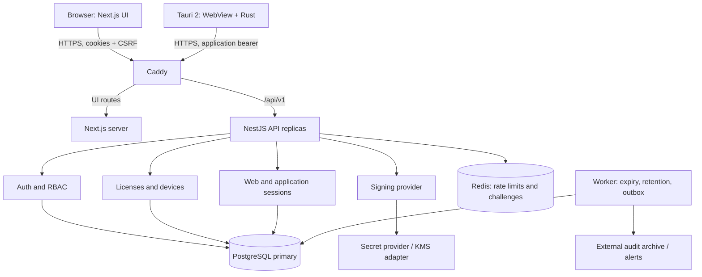
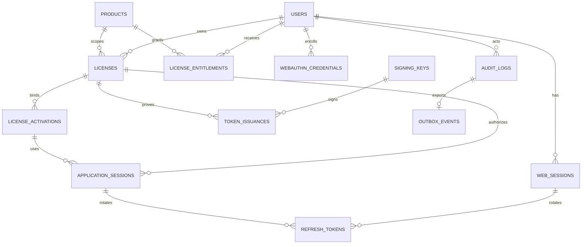
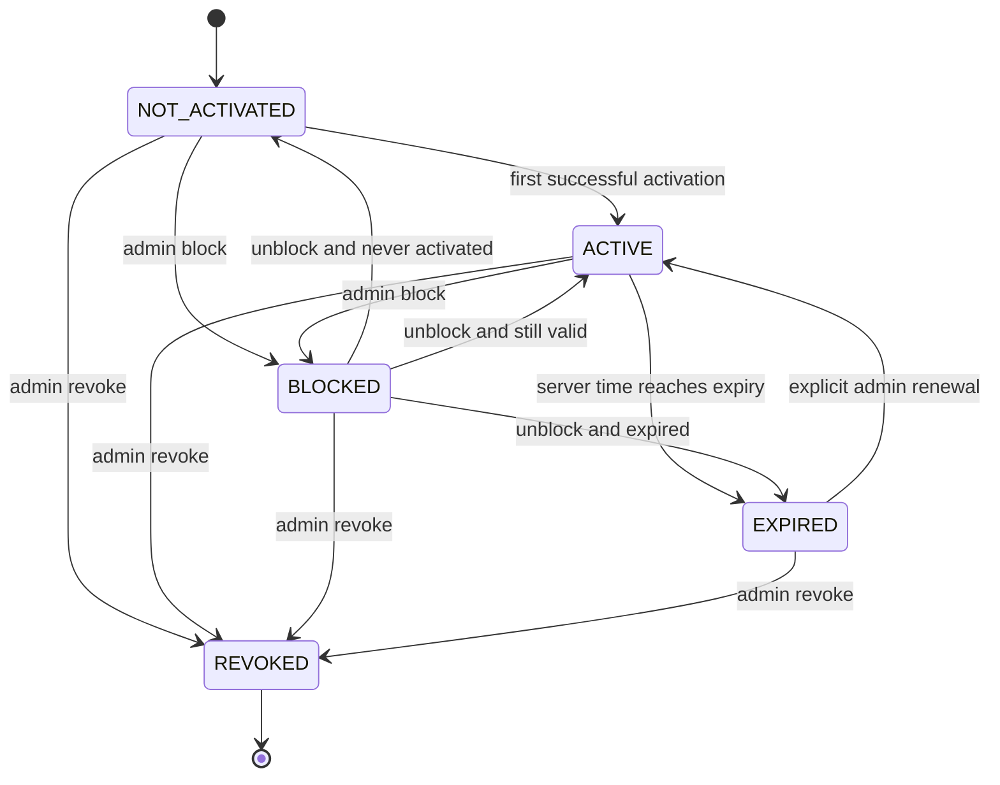
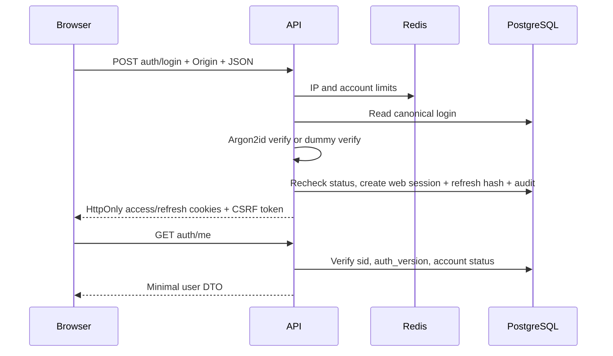
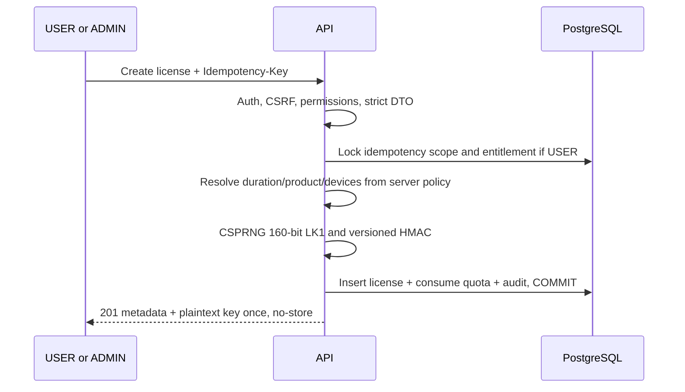
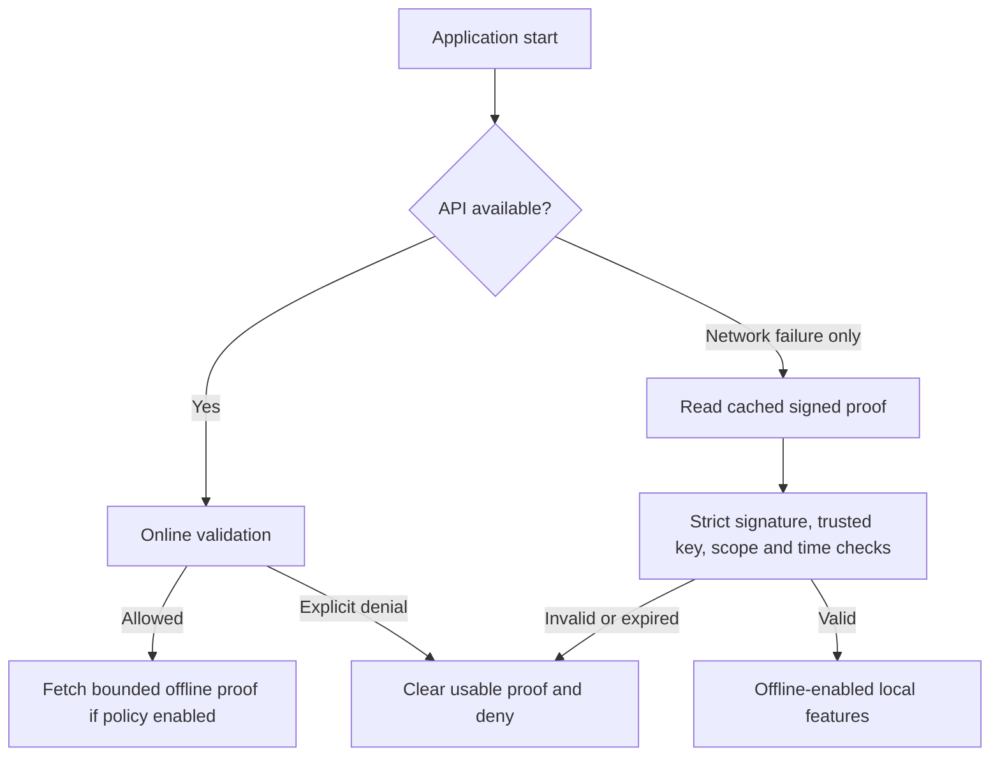
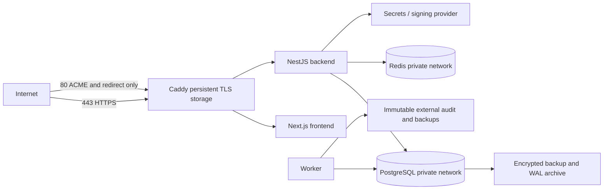

# OnlineKeyGen — архитектура системы лицензирования

Версия документа: 1.0. Дата: 2026-09-18. API: `/api/v1`. Формат ключа: LK1. Протокол подписанных утверждений: LP1.

Статус: проектное решение до реализации; это не отчёт о готовности системы к production. Все настройки ниже — выбранные исходные политики, которые должны быть закреплены кодом, миграциями и тестами. Домен, реальные продукты, политика коммерческой выдачи, SLO и инфраструктура эксплуатации пока не заданы.

## 0. Принятые решения и слабые места требований

1. Backend и PostgreSQL принимают решения о доступе. Ни frontend, ни desktop, ни подписанное клиентское утверждение не заменяют актуальную серверную проверку.
2. Нельзя гарантировать исполнение локальных ограничений в полностью модифицированном desktop. Если вся ценность приложения доступна локально, атакующий может удалить проверку лицензии. Критичные серверные функции всегда проверяют авторизацию сами. Обфускация и anti-tamper этого ограничения не устраняют.
3. Offline-проверка не обеспечивает немедленный отзыв и достоверное время на враждебном устройстве. Даже семидневный proof ограничивает срок только у корректно работающего клиента. Строгая отзывность требует online-only продукта.
4. Device ID не доказывает физическую уникальность устройства. Он ограничивает зарегистрированные установки, но не предотвращает клонирование ID или локальных секретов. В базовой версии не собираем серийные номера оборудования.
5. License key — bearer credential. Тот, кто получил ключ, может активировать его до исчерпания лимита устройств. Вход по ключу даёт только доступ приложения, никогда не web-сессию владельца или административные права.
6. Самостоятельная выдача по умолчанию выключена. Простого флага «разрешено» недостаточно: нужны серверные entitlement, разрешённые сроки и атомарно расходуемая квота. Иначе пользователь сможет бесконечно создавать новые пробные лицензии. Массовая регистрация обходит квоту на аккаунт; платные права выдаются только из доверенного источника.
7. Пример из 16 символов Base32 имеет лишь 80 бит случайности. Выбираем 32 символа Base32 = 160 бит. Маска раскрывает 8 символов, оставляя 120 неизвестных бит; маска не является способом аутентификации.
8. Нельзя автоматически пересчитать HMAC старого ключа с новым секретом, имея только старый HMAC. Нужны версии HMAC, миграция при предъявлении ключа и перевыпуск при компрометации. Для неактивируемых старых ключей возможен длительный срок хранения старого секрета.
9. Публичный Ed25519-ключ не секретен, но его подлинность критична. Нельзя принимать ключ из самого LP1 или произвольного URL из header. Обновление доверенного набора ключей должно быть аутентифицировано.
10. Регистрация только по login/password не даёт безопасного восстановления забытого пароля. До появления отдельно спроектированного recovery нет публичного password-reset; поддержка не сбрасывает пароль по знанию login или User ID.
11. Полностью скрыть существование login при немедленной регистрации и уникальных именах нельзя: успех регистрации уже даёт сигнал. Используем одинаковый публичный ответ, не делаем auto-login и не обещаем абсолютную защиту от enumeration.
12. Для production ADMIN одного пароля недостаточно. Добавляем обязательный WebAuthn step-up; первый администратор создаётся операционной CLI, а не публичным API. Регистрационная форма остаётся из трёх полей.
13. «Append-only на уровне приложения» недостаточно против ошибочного UPDATE/DELETE. Runtime DB-role не получает такие права на audit. Против DB-superuser нужны внешние неизменяемые копии.
14. Сохранённый `ACTIVE` не заменяет проверку `expires_at`. Истечение вычисляется на каждом решении о доступе, даже если фоновый worker задержался.
15. ChaCha20-Poly1305 не включаем ради наличия шифрования: обычный offline proof подписан и открыт. Шифруем только реальные конфиденциальные серверные данные.

## 1. High-Level Architecture

Начинаем с модульного монолита NestJS: транзакции лицензирования проще проверять, чем распределённые операции между микросервисами. Web и desktop используют одни API и пользователей, но разные классы сессий и права.



Стек: Next.js + TypeScript + Tailwind + shadcn/ui; NestJS + TypeScript; PostgreSQL + Prisma; Redis; Caddy; Docker Compose. Версии зависимостей фиксируются lockfile, версии контейнеров — тегом и digest после проверки совместимости; плавающий `latest` не используется.

Desktop: Tauri 2, React/TypeScript для UI, Rust для сетевого клиента, OS credential storage и LP1 verification. Выбор оправдан небольшим интерфейсом, отсутствием зависимости от Node в desktop и системным WebView. Electron упростил бы единый JS runtime, но увеличивает поставку Chromium; native WinUI/WPF подходит для Windows-only, однако ограничивает переносимость. Целевая первая платформа — Windows; macOS/Linux требуют отдельных сборок и проверок credential storage.

Tauri capabilities разрешают только необходимые IPC-команды; remote content, shell execution и произвольные файловые пути не нужны. Это уменьшает последствия XSS, но Rust на машине пользователя не становится доверенным для backend. См. [модель безопасности Tauri](https://v2.tauri.app/security/).

## 2. Trust Boundaries

| Граница | Входящие данные | Обязательная проверка |
|---|---|---|
| Интернет → Caddy | HTTP, TLS, forwarding headers | TLS, body/timeout limits; удаление клиентских forwarded headers |
| Caddy → API | JSON, cookies, bearer | DTO allowlist, размер, authentication, CSRF для cookies, RBAC, ownership |
| Web server → API | SSR-запросы с пользовательскими cookies | Та же авторизация; Next.js не имеет service-admin credential |
| WebView → Rust | Команды IPC | Типы, allowlist команд и домена API; отсутствие произвольного HTTP proxy |
| Desktop → API | Key, device ID, product ID, LP1 | Всё недоверенно; проверяется серверное состояние |
| API → PostgreSQL | Prisma и raw SQL для locks | Параметризованные запросы, FK/CHECK, минимальные права |
| API → Redis | Лимиты и одноразовые challenge | Atomic scripts; недоступность не даёт обойти защиту |
| API → signer | Типизированный payload | Разрешённый purpose, активный key ID; нельзя подписывать произвольные клиентские байты |
| CI/operator → production | Артефакты, миграции, secrets | Отдельные идентичности, review, signed releases, аудит |

Сеть контейнеров не считается криптографическим доказательством доверия. В пределах одного узла используются изолированные сети; между узлами — TLS/mTLS. Redis не является хранилищем разрешений. Read replica не участвует в принятии решений об отзыве.

## 3. Threat Model

Активы: пользовательские пароли, лицензии и права, ключи подписи, refresh/session credentials, персональные данные, доступность, аудит. Противник может контролировать desktop и сеть, знать весь код и протокол; компрометация backend-host или privileged operator рассматривается отдельно.

| Threat | Attack scenario | Impact | Mitigation | Remaining risk |
|---|---|---|---|---|
| Database leak | Утечка snapshot/backup | PII, hashes и отношения пользователей | Encryption at rest, отдельные backup credentials, минимизация полей, секреты вне БД | Login, история и связи раскрываются |
| Stolen license database | Кража `key_hash` и масок | Попытка восстановить LK1 | HMAC с отдельным secret, 160 бит random, отсутствие plaintext | При утечке самого LK1 он usable до отзыва |
| Leaked HMAC hash | Попытка отправить hash вместо ключа | Обход активации | API принимает только формат LK1; hash не credential | С БД и HMAC-secret можно проверять догадки; энтропия остаётся защитой |
| Stolen user database | Offline password guessing | Захват аккаунтов | Argon2id, уникальные соли, сильные пароли, ADMIN WebAuthn | Слабые пароли могут быть взломаны |
| Stolen public key | Публичный verifier скачан | Подписи не подделываются | Public key рассчитан на публикацию | Подмена trust store на клиенте позволяет локальный bypass |
| Stolen private signing key | Подписываются ложные LP1 | Поддельные offline proofs | Изоляция signer, key revocation, короткий TTL, incident rotation | Отключённый клиент не узнаёт отзыв; online ещё требует DB session |
| Backend/DB write compromise | Атакующий меняет права и записи | Выпуск прав, кража данных | Least privilege, isolation, review, backups, incident recovery | Внутри данного trust domain полной защиты нет |
| Reverse engineering | Извлечение strings и логики | Понимание API, копирование клиента | В клиенте только public keys; серверные проверки | Нельзя скрыть протокол и локальную бизнес-логику |
| Modified executable | Вырезана проверка подписи/expiry | Нелицензионные локальные функции | Ценные серверные операции авторизуются API; signed updates | Локальную функциональность полностью защитить нельзя |
| MITM | Подмена API и ответов | Credential theft, ложные данные | TLS, hostname validation, без insecure bypass; release signing | Malware/root CA у владельца устройства может перехватывать данные |
| API replay | Повтор активации/мутации | Дубли, лишние сессии/лицензии | DB locks, idempotency key, session scope, WebAuthn challenge | Bearer-request можно повторить в пределах полномочий украденного токена |
| Token theft/session hijacking | XSS, malware, log leak | Временный доступ | HttpOnly cookie / OS vault, короткий TTL, server revocation, log redaction | Malware может действовать от имени живой сессии |
| Refresh theft/reuse | Украден старый rotating token | Длительное продление | Atomic consume, family revocation, абсолютный срок, reuse alert | Первое использование украденного актуального token может успеть пройти |
| Device ID spoofing | Клонирован installation UUID | Обход физического лимита | Явно считаем installations; аномалии, revoke device | Невозможно доказать физическую уникальность без отдельной attestation |
| License sharing | Владелец передаёт LK1 | Несанкционированные установки | Max devices, session limits, audit, device revocation | Общий device ID или совместное использование одной установки |
| Brute force | Массовые попытки паролей/ключей | Захват, DoS | Redis IP/account/device limits, сильная энтропия, bounded Argon2 concurrency | Botnet и account lockout abuse требуют edge-защиты |
| Credential stuffing | Пароли из других утечек | Захват аккаунта | Rate limits, ADMIN WebAuthn, breach-password policy | Пользователи без MFA остаются уязвимыми |
| Enumeration | Различающиеся ответы/время | Список login/валидных ключей | Generic auth errors, dummy Argon2 verify, uniform registration reply, отсутствие поиска login публично | Полностью убрать side channels и факт успешной регистрации нельзя |
| SQL injection | Управление фильтром/sort SQL | Чтение/изменение БД | Prisma, bound raw parameters, allowlist sort fields | Ошибки будущего handwritten SQL |
| XSS | Вредоносные login/metadata | Действия через web session | ASCII login, React encoding, CSP nonces, нет raw HTML | HttpOnly не мешает XSS выполнять запросы от имени пользователя |
| CSRF | Чужой сайт вызывает cookie API | Создание/отзыв прав | Origin allowlist + synchronizer token + SameSite | XSS bypasses CSRF defenses |
| Administrator compromise | Phishing или украденная admin session | Выпуск lifetime, массовый отзыв | WebAuthn step-up, краткая MFA-сессия, аудит, независимые alerts | ADMIN по назначению обладает мощными полномочиями |
| Clock rollback | Изменено локальное время, VM snapshot | Продление offline-use | Trusted server time anchor, monotonic clock в процессе, rollback → reconnect | Root и восстановление полного snapshot обходят локальную защиту |
| Dependency/update compromise | Вредоносный пакет или updater | Выполнение кода | Lockfiles, SBOM, scanning, отдельный update-signing key | Доверенная цепочка сборки тоже может быть скомпрометирована |
| Race condition | Параллельные активации сверх лимита | Over-activation | Lock license + count + insert одной транзакцией | Ошибка в другом mutation path может нарушить инвариант |
| Resource exhaustion | Argon2/verify flood, oversized token | Недоступность | Pre-auth rate limit, body/token caps, queues, timeouts | Volumetric DDoS требует внешнего провайдера |
| Audit tampering | Удаление следов злоупотребления | Потеря доказательств | DB grants append-only, transactional outbox, external archive | DB-superuser может изменить локальную историю |

## 4. Cryptographic Architecture

| Назначение | Примитив | Политика |
|---|---|---|
| Пароли | Argon2id | Отдельная соль 16+ bytes; PHC string; начально m=64 MiB, t=3, p=1; benchmark перед release |
| Поиск лицензий | HMAC-SHA-256 | 32+ random bytes secret, версия ключа, MAC canonical LK1 |
| Подпись LP1 | Ed25519 | Отдельные keys для application-session и offline-license |
| Web access | JWT HS256 | Отдельный 32+ byte secret; pinned alg/issuer/audience, sid; обязательная DB-session check |
| Refresh tokens | CSPRNG + SHA-256 digest | 32 random bytes; высокая энтропия позволяет быстрый digest; это не password hashing |
| Device/log fingerprints | SHA-256 либо отдельный HMAC | Не использовать license secret для иных назначений |
| Confidential server data | ChaCha20-Poly1305 | 256-bit key, 96-bit nonce, 128-bit tag, контекст в AAD |
| Transport | TLS | TLS 1.3 предпочтительно, минимум 1.2; сертификаты проверяются |

Argon2-параметры — выбранный профиль, а не гарантия определённой задержки на любом сервере. Ограничиваем одновременно выполняемые hash/verify и размер пароля до 128 Unicode code points и 1024 UTF-8 bytes; минимум 15 символов для password-only пользователей; пробелы не обрезаем, Unicode пароля не нормализуем. Валидация выполняется до дорогого hashing. Библиотечный verify; rehash при входе после изменения политики. См. [OWASP Password Storage](https://cheatsheetseries.owasp.org/cheatsheets/Password_Storage_Cheat_Sheet.html).

Node `crypto` выполняет CSPRNG, HMAC, Ed25519, AEAD и безопасное сравнение равнодлинных digest; Argon2 — поддерживаемая библиотека с PHC. В Rust — поддерживаемая Ed25519-библиотека со strict verification. Самодельных примитивов нет. Интеграция опирается на [Node crypto API](https://nodejs.org/api/crypto.html).

Нельзя передавать `key_hash` клиенту, сравнивать MAC обычным строковым `===` при проверке полученного MAC или декодировать неподписанный payload как доверенный. Индексный поиск digest в PostgreSQL не является constant-time; обещания constant-time всего HTTP endpoint не даём.

ChaCha envelope: `version`, `suite`, `encryption_key_id`, `nonce`, `ciphertext`, `tag`. AAD содержит canonical `{version,suite,encryption_key_id,purpose,record_id}`. Нужны разные ключи для разных назначений. Для редких серверных secrets используем новый random 256-bit DEK на envelope, wrap через key provider и random 96-bit nonce; DEK никогда не переиспользуется для обновления записи. AEAD wrap под локальным KEK использует CSPRNG nonce с UNIQUE(key_id,nonce) в durable registry; reservation фиксируется до использования. При restore registry KEK меняется до новых операций. KMS wrapping делегируется провайдеру. Plaintext не выдаётся до проверки tag. Это envelope encryption для управления ключами, а не многослойное шифрование ради сложности. Требование уникальности nonce следует [RFC 8439](https://www.rfc-editor.org/info/rfc8439/).

## 5. License Protocol v1

### 5.1 LK1: предъявляемый лицензионный ключ

Генерация: 20 случайных bytes → uppercase RFC 4648 Base32 без padding → восемь групп по четыре символа:

`LK1-XXXX-XXXX-XXXX-XXXX-XXXX-XXXX-XXXX-XXXX`

Алфавит `A-Z2-7`. Placeholder выше не является выданным ключом. Canonical bytes для HMAC: ASCII `LK1-` + все 32 символа без внутренних дефисов. UI принимает только compact или точно grouped форму; допускается uppercase-конверсия ASCII и удаление пробелов только по краям. Unicode confusables, другие разделители, лишние символы и произвольная длина запрещены. Нормализация перед lookup и выдачей едина.

Маска: `LK1-ABCD-****-****-****-****-****-****-WXYZ`. В БД: digest, первые/последние четыре случайных символа, `hmac_key_id`. Полный ключ существует только в краткоживущей памяти и единственном ответе создания. Browser не кладёт его в localStorage, URL или analytics.

### 5.2 LP1: точный wire format

`LP1.BASE64URL(headerBytes).BASE64URL(payloadBytes).BASE64URL(signature)`

Ровно четыре сегмента; Base64url RFC 4648 без padding и с единственным canonical encoding. Подписываем ASCII-байты `LP1.` + encodedHeader + `.` + encodedPayload целиком, включая header. Ed25519 signature — ровно 64 bytes. Максимальная длина LP1 — 8192 bytes, header — 512 decoded bytes, payload — 4096 decoded bytes. Compression отсутствует.

`headerBytes` и `payloadBytes` — UTF-8 JSON, нормализованный готовой реализацией JCS [RFC 8785](https://www.rfc-editor.org/info/rfc8785/). LP1 дополнительно ограничивает числа безопасными целыми; даты — Unix seconds UTC; UUID и IDs — строки ASCII; `null` допускается только явно. Не допускаются duplicate JSON keys, floats, NaN/Infinity, неизвестные поля и неканоническая кодировка. Проверяющий парсер должен уметь обнаружить duplicate keys; обычного `JSON.parse` для этого недостаточно. Межъязыковые Node/Rust vectors обязательны.

Обычный header:

```json
{
  "version": 1,
  "type": "application-session",
  "signature_algorithm": "Ed25519",
  "encryption_algorithm": "none",
  "key_id": "session-2026-01"
}
```

Поля payload application-session:

| Поле | Тип/значение |
|---|---|
| `issuer` | Точное configured HTTPS issuer |
| `audience` | `application-api` |
| `session_id` | UUID серверной application session |
| `license_id`, `user_id`, `product_id` | UUID |
| `device_id` | UUID установки |
| `issued_at`, `expires_at` | Integer Unix seconds; TTL ≤ 300 seconds |
| `license_version` | Положительное целое; сверяется с БД |
| `nonce` | 16 CSPRNG bytes в Base64url; идентификатор утверждения |

Offline header отличается `type: offline-license`, key purpose и `encryption_algorithm: none`. Offline payload:

| Поле | Тип/значение |
|---|---|
| `version` | 1 |
| `issuer`, `audience` | Точный issuer; audience `offline-license` |
| `license_id`, `user_id`, `product_id`, `device_id` | UUID |
| `issued_at`, `valid_until` | Unix seconds |
| `license_expires_at` | Unix seconds или null только при lifetime |
| `lifetime` | Boolean |
| `license_version` | Версия на момент выдачи; offline не может узнать новую |
| `nonce` | 16 CSPRNG bytes в Base64url |

Семантика: `valid_until > issued_at`; TTL не больше product policy и абсолютного cap 7 дней; для temporary `valid_until <= license_expires_at`. Lifetime означает только отсутствие общего срока лицензии, а не бесконечный proof. Временной proof не содержит login и других ненужных PII.

Проверка LP1: ограничить размер → strict decode/header schema → найти key ID в доверенном наборе с верным purpose → проверить подпись над исходными сегментами → strict canonical payload/schema → сверить issuer/audience/type/product/device/time → для online сверить session и лицензию в БД. Unknown version/algorithm/key/type запрещены. `none` относится исключительно к encryption, а не к подписи. Никаких fallback algorithms или `jku`/`x5u`.

Nonce внутри LP1 не превращает bearer token в одноразовый. Такие токены могут законно использоваться многократно до expiry. Одноразовыми бывают challenge и idempotent mutations, а не каждое validation.

### 5.3 Optional encrypted profile

В первой поставке encrypted offline tokens отключены: payload не содержит секретов, которые необходимо скрывать от его владельца. Для будущего server-recipient профиля header фиксирует `ChaCha20-Poly1305`, отдельные `encryption_key_id` и `recipient_id`; payload segment кодирует canonical envelope `{nonce,ciphertext,tag}`. AAD — ASCII `LP1.` + encodedHeader; signature покрывает header и envelope. Проверка подписи предшествует дешифрованию. Ключ доставляется доверенному получателю отдельным протоколом, не через token. Обычный desktop такой профиль отвергает. Включение требует ADR по provisioning/rotation/nonce budget и тестов; generic header не включает его автоматически.

## 6. Key Management

Интерфейсы: `SigningProvider.sign(purpose,keyId,bytes)`, `VerificationKeyStore.get(keyId,purpose)`, `LicenseMacProvider.digest(keyId,canonicalKey)`, `SecretEnvelopeProvider.encrypt/decrypt(context,bytes)`. Доменные сервисы не читают `.env` напрямую.

Development adapter получает env/file secrets; production adapter допускает secret manager/Vault/KMS. Поддержку именно Ed25519 и нужного sign mode проверяем у выбранного провайдера: нельзя молча заменить Ed25519 RSA/ECDSA или подписать его неподходящим prehash API. Если KMS не поддерживает алгоритм — изолированный signer с секретом из Vault.

`signing_keys` хранит public material и opaque key reference, но не private key. Metadata: purpose, algorithm, status, activation/not-before, sign-until, verify-until, revoked-at. Active configuration меняется атомарно отдельно для каждого purpose. На startup проверяем соответствие public/private, длины secrets и отсутствие development placeholders; ошибки без значений секретов.

Отдельные ключи: license HMAC; JWT web access; session signing; offline signing; manifest signing root; AEAD KEK; observability fingerprint; desktop updater. Не переиспользуем `APPLICATION_SESSION_SECRET`, если application sessions подписываются Ed25519: такой secret исключается из итогового env вместо бессмысленного дублирования.

Private keys не попадают в Docker layers, build args, NEXT_PUBLIC variables, Git, Swagger examples, crash reports. Продакшен предпочтительно использует file mounts/workload identity; env — интерфейс совместимости, а не требование хранить всё в `.env`. Backup secrets отделён от DB backup. Root manifest key используется offline по операционной процедуре.

## 7. Database ER Diagram



`created_by` — отдельная связь licenses→users, не владелец. `audit_logs.actor_user_id` nullable для anonymous/system events. Один refresh token относится ровно к одному типу сессии.

## 8. Database Schema

Это нормативная логическая схема для Prisma + SQL migrations. Все ID — UUIDv7 от проверенной библиотеки; UUID не секрет и не permission. Даты — `TIMESTAMPTZ(3)`, UTC. `created_at` задаёт БД; `updated_at` поддерживается всеми mutation paths. FK обычно `ON DELETE RESTRICT`: production аккаунты блокируются/псевдонимизируются отдельной процедурой, а не каскадно удаляются вместе с audit.

| Таблица | Поля |
|---|---|
| `users` | `id uuid PK`, `login varchar(32) UNIQUE NOT NULL`, `password_hash text NOT NULL`, `role user_role NOT NULL DEFAULT USER`, `status account_status NOT NULL DEFAULT ACTIVE`, `auth_version int NOT NULL DEFAULT 1`, `created_at`, `updated_at` |
| `products` | `id uuid PK`, `name varchar(100)`, `slug varchar(64) UNIQUE`, `status product_status`, `offline_enabled bool DEFAULT false`, `offline_grace_seconds int DEFAULT 86400`, `created_at`, `updated_at` |
| `license_entitlements` | `id uuid PK`, `user_id FK`, `product_id FK`, `remaining_issues int`, `allowed_durations int[]`, `allow_lifetime bool DEFAULT false`, `max_devices int NULL`, `expires_at NULL`, `version int`, timestamps; UNIQUE(user_id,product_id) |
| `licenses` | `id uuid PK`, `user_id FK NOT NULL`, `product_id FK NOT NULL`, `key_hash bytea UNIQUE NOT NULL`, `hmac_key_id varchar(64) NOT NULL`, `key_prefix char(4)`, `key_suffix char(4)`, `status license_status`, `duration_seconds bigint NULL`, `activated_at NULL`, `expires_at NULL`, `is_lifetime bool`, `max_devices int NULL`, `activation_count bigint DEFAULT 0`, `created_by uuid FK NOT NULL`, `version int DEFAULT 1`, `revoked_at NULL`, `blocked_at NULL`, timestamps |
| `license_activations` | `id uuid PK`, `license_id FK`, `device_id uuid`, `first_seen_at`, `last_seen_at`, `revoked_at NULL`; UNIQUE(license_id,device_id) |
| `application_sessions` | `id uuid PK`, `license_id`, `user_id`, `product_id`, `activation_id`, `device_id`, `license_version int`, `created_at`, `last_seen_at`, `absolute_expires_at`, `idle_expires_at`, `revoked_at NULL`, `revoke_reason NULL` |
| `web_sessions` | `id uuid PK`, `user_id FK`, `auth_version int`, `csrf_token_hash bytea`, `created_at`, `last_seen_at`, `absolute_expires_at`, `idle_expires_at`, `mfa_verified_at NULL`, `revoked_at NULL` |
| `refresh_tokens` | `id uuid PK`, `token_hash bytea UNIQUE`, `kind WEB/APPLICATION`, `web_session_id FK NULL`, `application_session_id FK NULL`, `parent_id uuid UNIQUE FK NULL`, `replaced_by_id uuid UNIQUE FK NULL`, `created_at`, `expires_at`, `consumed_at NULL`, `revoked_at NULL`; family = associated session |
| `signing_keys` | `id varchar(64) PK`, `purpose`, `algorithm`, `public_key bytea`, `provider_ref text NULL`, `status PENDING/ACTIVE/VERIFY_ONLY/REVOKED/RETIRED`, `not_before`, `sign_until`, `verify_until`, `created_at`, `revoked_at NULL` |
| `token_issuances` | `id uuid PK`, `license_id FK`, `application_session_id FK`, `signing_key_id FK`, `purpose`, `nonce bytea UNIQUE`, `issued_at`, `valid_until`, `license_version`; хранится metadata, не полный bearer token |
| `audit_logs` | `id uuid PK`, `actor_user_id FK NULL`, `actor_kind`, `action varchar(80)`, `target_type varchar(40)`, `target_id text NULL`, `metadata jsonb`, `request_id uuid`, `created_at` |
| `security_events` | `id uuid PK`, `event_type`, `severity`, `actor_user_id FK NULL`, `source_fingerprint bytea NULL`, `metadata jsonb`, `request_id uuid`, `created_at` |
| `outbox_events` | `id uuid PK`, `audit_id uuid UNIQUE FK NULL`, `topic`, `payload jsonb`, `created_at`, `delivered_at NULL`, `attempt_count int` |
| `idempotency_records` | `actor_scope text`, `route text`, `key uuid`, `request_hash bytea`, `resource_id uuid NULL`, `created_at`, `expires_at`; composite PK(scope,route,key) |
| `webauthn_credentials` | `id uuid PK`, `user_id FK`, `credential_id bytea UNIQUE`, `public_key bytea`, `sign_count bigint`, `transports text[]`, `created_at`, `last_used_at NULL`, `revoked_at NULL` |
| `crypto_nonce_reservations` | `key_id varchar(64)`, `nonce bytea`, `created_at`; PK(key_id,nonce), nonce length 12; только для local KEK wrapping |

Enums: `account_status ACTIVE/BLOCKED`; `product_status ACTIVE/DISABLED`; `user_role USER/ADMIN` (расширяется миграцией); `license_status NOT_ACTIVATED/ACTIVE/EXPIRED/REVOKED/BLOCKED`.

Критичные constraints:

- Login хранится lowercase ASCII; вход допускает uppercase ASCII и приводит к lowercase. SQL CHECK `login ~ '^[a-z0-9][a-z0-9_]{2,31}$'`; никаких Unicode lookalikes. Сравнение/unique на уже canonical строке. Переименование login не меняет User ID.
- Digest lengths: key/refresh/CSRF hashes 32 bytes; private key columns отсутствуют.
- Lifetime: `is_lifetime AND duration_seconds IS NULL AND expires_at IS NULL`; temporary: `NOT is_lifetime AND duration_seconds BETWEEN 1 AND 315360000`; после активации temporary expiry обязателен и больше activated_at. Custom cap — десять лет, меняется через ADR.
- До активации `expires_at IS NULL`; NOT_ACTIVATED требует `activated_at IS NULL`; ACTIVE/EXPIRED требуют `activated_at IS NOT NULL`. EXPIRED не бывает lifetime. BLOCKED/REVOKED могут быть до активации.
- `max_devices IS NULL OR max_devices >= 1`; `activation_count >= 0`; `version > 0`. Activation count — число когда-либо зарегистрированных уникальных устройств, не текущий расход лимита. Лимит считается по non-revoked activation rows.
- `status = REVOKED` эквивалентен `revoked_at IS NOT NULL`; `status = BLOCKED` эквивалентен `blocked_at IS NOT NULL`. История блокировок хранится audit, после unblock текущее blocked_at очищается.
- `last_seen_at >= first_seen_at`; offline grace 60..604800; entitlement.remaining_issues ≥ 0; allowed durations положительные и в пределах cap.
- Составной UNIQUE licenses(id,user_id,product_id) + composite FK application_sessions запрещает несогласованного владельца/продукт. UNIQUE activations(id,license_id,device_id) + composite FK session запрещает чужое устройство.
- В refresh_tokens CHECK XOR web/application session и соответствие kind. Family-consistency parent/child обеспечивается constraint trigger плюс транзакцией; одна живая цепочка на сессию.
- На signing_keys partial UNIQUE(purpose) WHERE status='ACTIVE'. Отдельный CHECK корректного порядка времён и согласованности revoked status.

Правила, зависящие от текущего времени и других строк, нельзя надёжно выразить простым CHECK: expiry «сейчас», max devices, квоты, current active key. Их обеспечивают транзакционные сервисы; structural constraints дополняют их. Для переходов license status используется SQL trigger с таблицей разрешённых переходов и доменная проверка.

Индексы: licenses(user_id,created_at,id), licenses(product_id,status,expires_at), partial licenses(expires_at) WHERE status='ACTIVE'; users(login), users(status,created_at,id); activations(license_id) WHERE revoked_at IS NULL; sessions(license_id,revoked_at), refresh_tokens(expires_at); audit_logs(created_at,id), (actor_user_id,created_at), (target_type,target_id,created_at). Keyset pagination, max page 100. Login prefix search через индекс; substring search добавляется с pg_trgm по измеренной необходимости.

Prisma отражает основные модели; CHECK, partial indexes, triggers, DB grants и составные инварианты добавляются явными SQL migrations. `prisma db push` не применяется к production. Миграционный пользователь отделён от runtime; runtime audit INSERT/SELECT без UPDATE/DELETE/TRUNCATE.

### State transitions



REVOKED необратим: нужна новая лицензия. BLOCKED не замораживает время. EXPIRED нельзя оживить обычной активацией. Renewal отдельное административное изменение срока с причиной; сохраняет activated_at, меняет expires_at и duration_seconds согласованно. На lifetime переход только ADMIN; обратный переход требует явного нового срока. Любая смена прав/срока/статуса увеличивает license.version и отзывает связанные application sessions. Для materialized ACTIVE с истёкшим временем сначала применяется effective EXPIRED. Worker материализует expiry, но не отвечает за корректность доступа.

## 9. Permission Model

| Операция | Anonymous | USER web | ADMIN web + MFA | Application session |
|---|---|---|---|---|
| Register/login | Да, limits | Да | Да | Нет |
| Профиль и собственные licenses | Нет | Только self | Self или отдельный admin endpoint | Только минимальный профиль ответа приложения |
| Создать лицензию себе | Нет | Только entitlement | Через admin policy | Нет |
| Выдать другому пользователю | Нет | Нет | Да | Нет |
| Lifetime/custom/max_devices | Нет | Только заранее выданная policy, без arbitrary fields | Да, bounds и audit | Нет |
| Роль пользователя | Нет | Нет | Нет публичного изменения в v1 | Нет |
| Block/unblock account/license, revoke | Нет | Нет | Да, reason и step-up | Нет |
| Activate LK1 | По ключу | По ключу | По ключу | Не требуется |
| Validate/refresh/offline | Нет | Нет | Нет | Только своя session/license/product/device |
| Audit/statistics | Нет | Нет | Да | Нет |

Permissions — серверная mapping roles→capabilities с default deny. Route guard проверяет identity + permission; domain service проверяет owner/product/status и limits. USER DTO не содержит user_id, status, created_by или role; неизвестные поля дают 400. Ownership включается в DB query, недоступный ресурс возвращает 404. Будущие SUPPORT/MODERATOR добавляются capability mapping, без условий вида «любой не-USER — admin».

Bootstrap ADMIN CLI требует операционного доступа и аудит; не содержит default password. WebAuthn enrollment первого credential требует bootstrap/in-person операционной процедуры или уже подтверждённого admin authenticator. Вход только по паролю не разрешает enrolment нового authenticator администратору. Защита от блокировки последнего активного администратора; break-glass процедура отдельно аудируется.

## 10. Authentication Flow

Регистрация принимает только `login`, `password`, `confirm_password`. Password/confirm не логируются, confirm не сохраняется. Создаются UUID, USER, ACTIVE и audit одной транзакцией. Endpoint возвращает одинаковый 202 для нового и занятого корректного login; пользователю предлагается войти. Для неизвестного login выполняется dummy Argon2 verify с текущей cost policy; ошибки пароля, blocked user и неизвестного login публично одинаковы.



Web JWT: TTL 5 минут, issuer точный, audience `web-api`, subject user UUID, sid, auth_version, iat, exp, jti. Role из JWT не является источником прав: актуальные role/status читаются сервером. JWT библиотечный, HS256 allowlist, поддержка kid и текущего/предыдущего ключа. Access-cookie `__Host-web_access`; refresh-cookie `__Host-web_refresh`; Secure, HttpOnly, SameSite=Lax, Path=/, без Domain. Ни один token не сохраняется в localStorage.

CSRF: login/register проверяют точный Origin, JSON content type и Fetch Metadata. Аутентифицированные mutations дополнительно требуют `X-CSRF-Token`, привязанный к web_session; клиент получает token в ответе login/refresh, хранит в памяти, а после reload через защищённый same-origin `GET /auth/csrf`. Endpoint выпускает новый CSRF token с заменой hash; вкладки синхронизируют его. CORS чужим origins не разрешает чтение. Потеря CSRF token не требует чтения HttpOnly cookie.

WebAuthn использует библиотечную верификацию challenge, RP ID, origin и user verification; одноразовые challenges с TTL 5 минут. Для admin routes требуется MFA не старше 15 минут, для опасных mutations — не старше 5 минут. RP ID и allowed origins конфигурируются строго, не из HTTP Host.

## 11. User Session Flow

Web session: абсолютный срок 30 дней, idle 7 дней; ADMIN: absolute 12 часов, idle 30 минут. Application session: absolute 30 дней, idle 7 дней, access LP1 5 минут. Все сроки ограничиваются текущим сроком лицензии для application. Lifetime не продлевает session TTL до бесконечности.

Refresh: 32 random bytes Base64url. БД хранит SHA-256 digest и цепочку replacement; родитель остаётся до конца жизни family и установленного retention. Atomic transaction: lock session family → lookup/lock token → проверить status/expiry/type → пометить consumed → вставить child → audit → commit. Повтор consumed/revoked token отзывает family, все её живые tokens и sessions; security event фиксируется до ответа ошибки, а не откатывается вместе с exception. Подход rotation/reuse соответствует [RFC 9700](https://www.rfc-editor.org/rfc/rfc9700.html).

Вкладки используют single-flight refresh (Web Locks/BroadcastChannel). Не вводим grace window, в котором один старый bearer token выдаёт несколько successors. Потерянный ответ refresh может потребовать нового login; безопасность важнее бесшовности при сетевой гонке. Повторный refresh после неизвестного результата не скрывается автоматическим retry middleware.

Logout отзывает server session/family и очищает cookies. Password/role/status changes увеличивают auth_version и отзывают web sessions; block account также инвалидирует все app sessions через проверку users.status. APP refresh выдаётся при activation в body и хранится только OS credential store; web refresh и app refresh не взаимозаменяемы. Application logout имеет отдельный endpoint.

## 12. License Generation Flow



Предустановки секунд: 3600, 43200, 86400, 259200, 604800, 1209600, 2592000, 7776000, 15552000, 31536000. Дни — ровно 86400 секунд, не календарные месяцы/DST. Custom только целое 1..315360000; lifetime — отдельный discriminator без duration. Новый key всегда NOT_ACTIVATED, activated_at/expires_at null.

USER получает только product_id и policy option, owner берётся из session. ADMIN передаёт user_id, product_id, одну из duration/lifetime, max_devices и reason. Проверяется существование и статус owner/product; выдача blocked account запрещена.

Idempotency обязателен на create: повтор с тем же телом возвращает resource metadata и `key_recoverable:false`, но не plaintext; другое тело с тем же ключом → 409. Потерянный ключ восстановить нельзя: admin revoke/reissue, а entitlement compensation — явное аудируемое действие. Нельзя хранить plaintext ради повторной доставки. Уникальное ограничение + bounded retry закрывают невероятную CSPRNG collision.

## 13. License Activation Flow

```mermaid
sequenceDiagram
    participant C as Desktop Rust
    participant A as API
    participant D as PostgreSQL primary
    C->>A: LK1 + product_id + device_id
    A->>A: Rate limits, strict format, HMAC lookup
    A->>D: BEGIN; lock product SHARE, user SHARE, license UPDATE
    A->>D: Re-read status/version/time; count active devices
    A->>D: Upsert permitted activation; first activation timestamps
    A->>D: Insert app session + refresh digest + audit
    A->>A: Sign 5-minute LP1 using typed server claims
    A->>D: COMMIT
    A-->>C: User/license DTO + LP1 + app refresh
```

HMAC lookup пробует активную и ограниченное число verify-only MAC versions, используя индекс `(hmac_key_id,key_hash)`. Входящий key никогда не является query parameter URL. После предварительного lookup авторизация повторяется под locks. Порядок locks одинаков у всех операций: product → user → license → activation → session → refresh; на множестве licenses — сортировка UUID. Изменения продукта и аккаунта используют соответствующий exclusive lock, чтобы не обгонять проверку.

Первый activation time берётся от БД после получения locks (`clock_timestamp()`, один сохранённый value); transaction-start `now()` может устареть при долгом ожидании. Для temporary expiry = activation + duration; округление Unix seconds не продлевает срок. Повтор того же device не расходует новое место и не сбрасывает activated_at. Revoked device нельзя автоматически «восстановить» предъявлением ключа. Новое устройство проверяется по count активных rows внутри того же license lock. Default max_devices=1, unlimited доступен только через явную admin policy.

Все device-mutating operations берут тот же license lock. `SELECT ... FOR UPDATE` и блокирующие чтения используют параметризованный SQL в Prisma transaction; семантика описана в [PostgreSQL Explicit Locking](https://www.postgresql.org/docs/17/explicit-locking.html). Retry serialization/deadlock ограничен тремя попытками с jitter; business errors не retry.

Подпись и выдача не должны пережить rollback: ответ отправляется только после commit. Signer failure откатывает activation/session transaction, клиент не получает частичный успех. Signer имеет короткий timeout; при переносе в высоколатентный KMS допустима отдельная prepare/recheck схема через ADR. Повтор activation того же device отзывает прежнюю активную application session для этого устройства и создаёт новую, не размножая сессии при retry. Пользователю показывается, что повторный вход отключит предыдущую сессию этой установки.

Ошибки, связанные с неизвестным ключом, неправильным product, blocked account или неизвестным product, внешне объединяются в `INVALID_LICENSE`. Только после совпадения LK1 и product допускаются `LICENSE_EXPIRED`, `LICENSE_REVOKED`, `LICENSE_BLOCKED`, `DEVICE_LIMIT_REACHED`; это сознательно раскрывает состояние обладателю валидного bearer secret. User/login при ошибке не возвращаются.

## 14. License Validation Flow

POST `/licenses/validate`: application bearer LP1 в Authorization, body `{product_id,device_id}`. Не принимает raw license key и не принимает web cookie как credential.

Порядок: LP1 strict verify → разрешённый purpose/key/audience → token time → server session → exact token-to-row binding всех IDs/version → user ACTIVE → product ACTIVE → license ACTIVE и не истёкшая → activation не отозвана → session idle/absolute/revocation → success. Время сервера/БД определяет доступ; skew для future iat максимум 30 секунд, но не даёт продлить license expiry. `last_seen_at` можно обновлять не чаще раза в минуту, не отменяя проверку срока.

Одна согласованная read snapshot с JOIN исключает смешивание старых и новых прав. Revocation начинает действовать для проверок, начатых после её commit; уже исполняющийся разрешённый запрос нельзя «отменить задним числом». Критичная mutation ресурса проверяет/блокирует соответствующие license/user/product строки в той же транзакции, что и изменение ресурса.

Отдельный `/validate` не защищает другие endpoints магически: каждое защищённое действие приложения использует тот же guard/policy. Authorization decisions читаются с primary; положительный Redis cache не используется. При недоступности DB → 503, никаких «раз токен подписан — значит пустим».

Ответ содержит актуальный safe user/license/product DTO, `server_time`, `session.expires_at`, `next_validation_after_seconds` (начально 60). Validation не продлевает токен: продление только rotating `/application-sessions/refresh` с полным повтором policy checks. Просроченный access не требует снова вводить LK1, пока refresh valid.

## 15. Offline License Flow

Offline выключен по умолчанию для продукта. При включении default grace 24 часа, hard cap 7 суток. Получение proof требует живой application session и полной online validation, включает device/product и текущую license version.

`valid_until = min(server_now + product_grace, license_expires_at)` для temporary; для lifetime — только server_now + grace. TTL обязательно положительный. Issuance metadata и audit фиксируются транзакционно; signature возвращается после commit, `Cache-Control: no-store`.



Offline fallback допускается при транспортной недоступности/503, но никогда после явного revocation/block/expiry/invalid-session ответа. 401 из-за истечения access сначала требует refresh; не маскируется переходом offline. Proof не открывает web/admin API и не разрешает серверные операции.

Клиент хранит последнее доверенное server_time, локальный time anchor и максимальный observed time в защищённом OS storage. В процессе использует monotonic elapsed time; после перезапуска при явном откате часов или отсутствии anchor просит соединение. Это best-effort против случайной/простой подмены часов; VM snapshots, root и patched verifier полностью обходят локальную политику. Подпись удостоверяет, что сервер когда-то выдал proof, но не текущее состояние лицензии.

## 16. Device Binding Flow

Rust создаёт CSPRNG installation UUID один раз и хранит в OS credential storage. Device ID не содержит MAC address, username или серийный номер диска. Он стабилен для установки и меняется при потере хранилища; новая установка расходует новый device slot.

Сервер хранит уникальную пару license/device; last_seen обновляется при online validation. Отзыв устройства ставит revoked_at и отзывает его sessions/refresh chains. Повторное разрешение только отдельным admin restore, с проверкой лимита и audit. Offline proof старого устройства остаётся действителен у честного клиента до valid_until, если он не получил отзыв онлайн.

Снижение max_devices ниже количества активных devices → 409; сначала нужно явно отозвать выбранные устройства. Нельзя произвольно отключать «лишние» устройства без списка и audit. Клиентские device name/user-agent отображаются только после длиновой валидации и encoding и не участвуют в доверенных решениях.

Дополнительный product policy в будущем: hardware-backed key + proof-of-possession. Для этого нужен отдельный reviewed протокол/стандарт, например DPoP-подобное sender constraining с правильным challenge/replay cache. Один device ID не заменяет этот механизм; в LP1 v1 его наличие не заявляется.

## 17. Key Rotation Flow

### Signing keys

1. Создать новую пару внутри secret provider, зарегистрировать PENDING public key и purpose.
2. Выпустить versioned key manifest с issuer, manifest version, issued_at/expires_at, keys, purposes, public bytes и revoked key IDs; подписать отдельным offline root key. Desktop содержит root public key и исходный manifest.
3. Клиент обновляет manifest только по configured HTTPS endpoint, проверяет root signature/issuer/version/time; хранит максимальную версию против rollback. Unknown kid требует обновления online, offline — отказа. Загрузка не даёт доверия сама по себе.
4. Распространить manifest до начала подписи новым key; отложить activation на согласованное окно обновления. Приложения, давно не бывшие online, могут потребовать обновления.
5. В транзакции заменить ACTIVE key для purpose; старый → VERIFY_ONLY. Новые токены подписываются только новым ключом.
6. Старый public key хранится до максимального срока ранее подписанных токенов + skew; private signing capability старого ключа удаляется раньше, после переключения и окна аварийного rollback.
7. При compromise: key → REVOKED, immediate online denial для его токенов, отзыв затронутых sessions, новый manifest, обновление клиентов и audit. Offline-клиент может оставаться уязвимым до reconnect; ключ root обновляется через подписанный release с отдельным update trust root.

Manifest — отдельный административный формат, не лицензия; его root не используется для session или offline-license подписи. Хранение только root private в том же backend свело бы изоляцию к нулю.

### HMAC

Новые LK1 получают active HMAC key ID. На activation сервер вычисляет MAC по ограниченному allowlist старых версий. После совпадения и успешной validation пересчитывает hash новым secret под license lock, поскольку plaintext доступен в этом запросе. Неактивные и lifetime keys нельзя мигрировать фоново без plaintext. Плановое удаление старого secret требует reissue оставшихся keys; компрометация — принудительный отзыв/reissue, а не бесконечное сохранение verify-only.

### Web JWT и AEAD

JWT signing secret ротируется с перекрытием максимум access TTL + skew; при compromise web sessions/families отзываются. KEK rotation rewraps DEK, не требует дешифровать каждый payload до application plaintext, если provider поддерживает rewrap; локальный adapter decrypts/wraps DEK внутри сервера. Старые KEK сохраняются до миграции envelopes и истечения backup retention. Ключи разных purposes ротируются независимо.

## 18. API Specification

### Общие правила

JSON UTF-8; snake_case DTO; UUID строки; даты в ответах RFC3339 UTC с `Z`; LP1 timestamps — Unix seconds. Запросы max 32 KiB, LP1 max 8 KiB; лимит в proxy и API. Неизвестные DTO поля запрещены. Ответы с auth/license secrets — no-store. Authorization/cookies/body secrets не логируются. Pagination `cursor`, `limit` default 25 max 100; allowlist search/filter/sort.

Ошибка: `{ "error": { "code": "INVALID_LICENSE", "message": "Не удалось активировать лицензию", "request_id": "UUID" } }`. Валидационные ошибки указывают имя поля, не его секретное значение. Stack trace/SQL/provider errors только в очищенном internal log. HTTP: 400 malformed, 401 invalid auth, 403 permission/blocked/expired, 404 inaccessible resource, 409 transition/quota/conflict, 429 rate limit с Retry-After, 503 dependency unavailable. `INVALID_PRODUCT` доступен только аутентифицированному management API, а не анонимному lookup ключа.

Обозначения auth: Public; Web (cookie + CSRF на mutations); Admin (Web+permission+MFA); App (LP1 bearer); AppRefresh (отдельный token в JSON, не LP1).

### Auth и пользователи

| Method/path после `/api/v1` | Auth | Request → response |
|---|---|---|
| POST `/auth/register` | Public + Origin | login/password/confirm_password → 202 generic acknowledgement |
| POST `/auth/login` | Public + Origin | login/password → 200 user + csrf_token + Set-Cookie; либо generic 401 |
| POST `/auth/refresh` | Web refresh cookie + CSRF | пустой body → rotated cookies + csrf_token; reuse → 401/family revoke |
| POST `/auth/logout` | Web + CSRF | пустой body → 204, revoke family, clear cookies |
| GET `/auth/me` | Web | user id/login/role/status/created_at, no hashes |
| GET `/auth/csrf` | Web or valid web refresh session + same Origin policy | новый CSRF token; no-store |
| POST `/auth/password` | Web + CSRF | current_password/new_password/confirm → 204, revoke all sessions |
| POST `/auth/mfa/challenge` | Web | WebAuthn options, challenge TTL 5 min |
| POST `/auth/mfa/verify` | Web | WebAuthn assertion → 204, update mfa_verified_at |
| POST `/auth/mfa/enroll/challenge` | Admin step-up or operational bootstrap | Enrollment options |
| POST `/auth/mfa/enroll/verify` | same | Attestation response → credential metadata |
| GET `/products` | Web | active product IDs/names и доступные self-issue policies |

Refresh endpoint может работать при истёкшем access token: session берётся из refresh digest, CSRF сверяется с ней. Same-origin CSRF retrieval для refresh не потребляет refresh token и не выдаёт user info. GET Origin может отсутствовать: в этом случае требуется browser Fetch Metadata same-origin; для SSR — внутренний доверенный маршрут без открытия cross-origin доступа.

### User licenses

| Method/path | Auth | Request → response |
|---|---|---|
| GET `/licenses` | Web | cursor/status/product_id → own masked licenses |
| POST `/licenses` | Web + Idempotency-Key | product_id, duration_option → 201 license + plaintext license_key once |
| GET `/licenses/:id` | Web ownership | masked license, product, dates, permitted device metadata |

### Application

| Method/path | Auth | Request → response |
|---|---|---|
| POST `/licenses/activate` | LK1 + limits | license_key/product_id/device_id → 200 safe user/license/session/refresh |
| POST `/licenses/validate` | App | product_id/device_id → 200 current user/license/session/server_time |
| POST `/licenses/offline-token` | App | product_id/device_id → 200 LP1 proof + valid_until |
| POST `/application-sessions/refresh` | AppRefresh | refresh_token/product_id/device_id → new LP1 + rotating refresh |
| POST `/application-sessions/logout` | App | empty → 204 revoke session/family |
| GET `/signing-keys/manifest` | Public | root-signed manifest, bounded cache, no private/provider refs |

Activation response shape:

```json
{
  "success": true,
  "user": {"id": "uuid", "login": "example"},
  "license": {
    "id": "uuid", "product_id": "uuid", "status": "ACTIVE",
    "lifetime": false, "expires_at": "2026-10-18T12:00:00Z"
  },
  "session": {"token": "LP1 token", "expires_at": "2026-09-18T12:05:00Z"},
  "refresh": {"token": "opaque token", "expires_at": "2026-09-25T12:00:00Z"},
  "server_time": "2026-09-18T12:00:00Z"
}
```

Это схема ответа с обозначениями типов, не реальные credentials. App error codes: INVALID_LICENSE, LICENSE_EXPIRED, LICENSE_REVOKED, LICENSE_BLOCKED, DEVICE_LIMIT_REACHED, DEVICE_REVOKED, INVALID_SESSION, SESSION_EXPIRED, OFFLINE_DISABLED, RATE_LIMITED, SERVICE_UNAVAILABLE. Desktop переводит их в понятные сообщения; неизвестная ошибка → общее сообщение с request ID.

### Administration

| Method/path | Auth | Request → response |
|---|---|---|
| GET `/admin/statistics` | Admin | total_users, total_licenses и effective status counts; lifetime отдельный пересекающийся count |
| GET `/admin/users` | Admin | login_prefix/role/status/cursor/limit → paged users + license count |
| GET `/admin/users/:id` | Admin | user profile + own resource links |
| POST `/admin/users/:id/block` | Admin step-up | reason, expected_version → blocked + sessions revoked |
| POST `/admin/users/:id/unblock` | Admin step-up | reason → active; старые sessions не оживают |
| GET `/admin/licenses` | Admin | owner/product/status/lifetime/cursor filters → masked licenses |
| GET `/admin/licenses/:id` | Admin | metadata + devices + activation/session metadata |
| POST `/admin/licenses` | Admin step-up + Idempotency-Key | user_id/product_id/duration-or-lifetime/max_devices/reason → key once |
| POST `/admin/licenses/:id/revoke` | Admin step-up | reason, expected_version → REVOKED |
| POST `/admin/licenses/:id/block` | Admin step-up | reason, expected_version → BLOCKED |
| POST `/admin/licenses/:id/unblock` | Admin step-up | reason, expected_version → recomputed state |
| PATCH `/admin/licenses/:id` | Admin step-up | exactly one term mutation plus reason/expected_version; optional bounded max_devices |
| POST `/admin/licenses/:id/devices/:device_id/revoke` | Admin step-up | reason → device/session revoke |
| POST `/admin/licenses/:id/devices/:device_id/restore` | Admin step-up | reason → restore if capacity allows |
| GET `/admin/audit-logs` | Admin | actor/action/target/time/cursor → redacted audit |
| GET `/admin/security-events` | Admin | severity/type/time/cursor → events |
| PUT `/admin/users/:id/entitlements/:product_id` | Admin step-up | quota/allowed durations/lifetime/device policy/reason → entitlement |

PATCH terms — discriminated union: `set_unactivated_duration`, `extend_by_seconds`, `set_expires_at`, `set_lifetime`. Unactivated не принимает expiry; активированная temporary новая expiry должна быть > server_now и activated_at; extend expired считается от max(old_expiry,server_now); lifetime→temporary только `set_expires_at`. `user_id`, `product_id`, `key_hash`, `activated_at`, arbitrary status никогда не редактируются. `expected_version` предотвращает lost update: mismatch → 409. В API block user версия — users.auth_version.

Продукты в первой поставке provision через audited operational CLI; дальнейший management API отдельным расширением. ADMIN не меняет signing keys через обычную панель. Actions audit пишется в той же транзакции; отсутствие audit storage блокирует mutation.

NestJS Swagger decorators/DTO генерируют OpenAPI через [официальный модуль](https://docs.nestjs.com/openapi/introduction). Контракт включает cookie/bearer security schemes, CSRF header, response DTO, стабильные ошибки и параметры pagination. CI проверяет schema drift и generate client types. Swagger UI выключен публично в production; JSON spec поставляется как артефакт.

## 19. Directory Structure

```text
OnlineKeyGen/
  apps/
    api/
      src/
        main.ts
        app.module.ts
        common/{guards,filters,validation,logging}/
        modules/{auth,rbac,users,products,licenses,devices,sessions}/
        modules/{signing,offline,audit,security-events,rate-limit,health}/
        providers/{database,redis,secrets}/
      prisma/{schema.prisma,migrations}/
      test/{integration,api,concurrency}/
      Dockerfile
    web/
      app/{auth,dashboard,admin}/
      components/{ui,licenses,users}/
      lib/{api,csrf,session}/
      Dockerfile
    desktop/
      src/{screens,components,api}/
      src-tauri/{src,capabilities,icons}/
    worker/
      src/{expiry,outbox,retention}/
      Dockerfile
  packages/
    contracts/
    lp1-spec/{schemas,vectors}/
    crypto-server/
    lp1-verifier/
    config/
    ui/
  infra/{caddy,postgres,redis}/
  scripts/{bootstrap,keys,openapi}/
  docs/{ARCHITECTURE.md,IMPLEMENTATION_PLAN.md,adr,runbooks}/
  Dockerfile
  docker-compose.yml
  docker-compose.production.yml
  .env.example
  package.json
  package-lock.json
  tsconfig.base.json
```

Это план расположения, не заявление, что файлы уже созданы. Общий `crypto-server` содержит только серверные adapters и запрещён в browser/desktop dependency graph; `lp1-verifier` содержит public verification, не signing. Rust verifier использует те же schemas/vectors, а не импортирует Node crypto. UI не импортирует Prisma models; публичные DTO исключают secrets явно. Один доменный LicenseService обслуживает user/admin/application контроллеры с разными permissions.

Monorepo — npm workspaces, один lockfile, строгий TypeScript. ESLint boundaries запрещают client → server imports. Пакеты именуются по назначению, без альтернативных конкурирующих реализаций auth/licensing.

## 20. Deployment Architecture



Compose dev: frontend, backend, postgres, redis, reverse-proxy, worker и одноразовый migrate service. Root multi-stage Dockerfile может служить единым entry build; app Dockerfiles/targets не дублируют бизнес-логику. Production compose не публикует PG/Redis/backend ports; только Caddy 80/443. Запуск без root, read-only root filesystem где возможно, tmpfs, drop capabilities, no-new-privileges, resource limits и healthchecks. Не монтировать Docker socket.

Caddy выдаёт/обновляет сертификаты при корректных DNS и ACME reachability, а не просто от наличия compose-файла; [Automatic HTTPS](https://caddyserver.com/docs/automatic-https). TLS policy минимум 1.2; HSTS включается после проверки реального домена и subdomains. API trust proxy задаётся точным hop/network allowlist, чтобы X-Forwarded-For не обходил limits.

PostgreSQL — durable volume, регулярный encrypted full backup + WAL/PITR, проверка restore. Redis — authentication/ACL, memory limit, noeviction для security namespace; failure → 503 для auth/activation/admin/validation, а не безлимитный доступ. Отдельные Redis для cache и security по мере роста. Не хранить bearer tokens в Redis values.

Compose на одном сервере не обеспечивает HA. Масштабирование: stateless API replicas, общий primary PostgreSQL и Redis, лимит пулов connections, PgBouncer после проверки Prisma transaction mode, outbox workers с SKIP LOCKED; read replicas только для аналитики с указанием задержки. HA PostgreSQL/Redis и multi-node orchestration — следующий инфраструктурный уровень, без заявления о готовности Compose к отказу узла.

Deploy: build/test/scan → backup и migration review → одноразовый migrate deploy → backward-compatible API rollout → web/worker → smoke tests. Expand/contract migrations; не выполнять миграции каждой API replica на startup. Rollback приложения не означает rollback потери данных; DB forward-fix и backup restore — отдельные runbooks.

Secrets пример содержит только имена/пустые значения: DATABASE_URL, REDIS_URL, WEB_ORIGIN, API_ISSUER, JWT_ACCESS_ACTIVE_KEY_ID, JWT_ACCESS_SECRET, LICENSE_HMAC_ACTIVE_KEY_ID, LICENSE_HMAC_SECRET, ED25519_SESSION_ACTIVE_KEY_ID, ED25519_SESSION_PRIVATE_KEY_FILE, ED25519_OFFLINE_ACTIVE_KEY_ID, ED25519_OFFLINE_PRIVATE_KEY_FILE, TRUST_MANIFEST_PUBLIC_KEY_FILE, CHACHA_MASTER_KEY_FILE. Root/update private keys отсутствуют в обычном backend deployment. Настройки grace/limits/product policy не принимаются из клиента.

Observability: request ID, latency/error counters, rate-limit counters, signer failures, DB saturation, outbox backlog, clock/NTP alerts. Labels не содержат login/keys/tokens и не имеют неограниченной cardinality. HTTP logger redacts Authorization, Cookie, Set-Cookie, password, confirm_password, license_key, refresh.token, session.token; response-body logging выключен по умолчанию. APM не сохраняет исходные request bodies.

Предварительные эксплуатационные ориентиры: RPO ≤15 минут, RTO ≤4 часа, monthly availability 99.9%; это целевые значения для инфраструктурного расчёта, не обеспеченные гарантии. Перед release — нагрузочный baseline и измерение стоимости Argon2 при лимитах контейнера.

## 21. Security Checklist и критерии приёмки

### Rate limits и detection

Начальные лимиты, требующие нагрузочной настройки; все измерения инкрементируются атомарно, отказ любого измерения отклоняет запрос:

| Endpoint | IP | Дополнительные dimensions |
|---|---|---|
| register | 5/hour | Edge global budget; downstream Argon2 queue |
| login | 20/5 min | 10/15 min на canonical account fingerprint; progressive cooldown |
| refresh | 60/min | 10/min per session, anomaly on reuse |
| activate | 30/5 min | 10/5 min key fingerprint; 20/5 min device; global failure-rate alert |
| validate | 600/min | 120/min session; 300/min license; 180/min device |
| offline-token | 30/hour | 6/hour session/device |
| admin reads | 120/min | 120/min actor |
| admin mutations | 30/min | 30/min actor, step-up required |

IP нормализуется включая IPv6; subnet limits — дополняющий edge control с учётом NAT. Account/device/key dimensions не заменяют IP/global, иначе атакующий генерирует новые значения. Rate-limit keys используют отдельный fingerprint HMAC, не plaintext key/login. Redis Lua выполняет atomic increment+expiry; bounded TTL и capped key growth. Credential-stuffing alarms агрегируют failures, не создают бесконечный DB event на каждую ошибку. Успешные административные события не sampling.

Security events: refresh reuse немедленно; bursts invalid-license/login-fail; резкое число device registrations; validation-rate аномалии; массовая выдача/lifetime/отзыв ADMIN; изменения entitlement; смена ключей и provider failures. Alerts уходят в настроенный operator sink через outbox без credentials. По умолчанию никаких внешних персональных сообщений не отправляется до настройки оператора.

### Web/API

- [ ] HTTPS, exact CORS allowlist, explicit credentials, Origin/Fetch Metadata и CSRF проверены.
- [ ] CSP с nonce/hash без production unsafe-eval; frame-ancestors none, X-Frame-Options DENY, nosniff, Referrer-Policy, ограниченный Permissions-Policy.
- [ ] JSON/body/header/token limits, timeout, DTO whitelist и параметризованные queries.
- [ ] SSR user data/no-store; Next caches не смешивают пользователей. Нет секретов в client bundle/source maps.
- [ ] Access/refresh HttpOnly/Secure/SameSite, no URL tokens; cookie deletion совпадает по path/domain.
- [ ] Admin MFA, step-up, deny-by-default RBAC и ownership в сервисах.
- [ ] Safe error envelope, sensitive log redaction, append-only audit grants.

### Licensing/crypto

- [ ] 160-bit CSPRNG keys; canonical LK1; HMAC lookup и versioning; plaintext не хранится.
- [ ] First activation атомарна, time от DB после locks; no reset on repeated activation.
- [ ] Все device mutations используют license lock; revoked device не resurrect.
- [ ] License/user/product/session/activation проверяются при каждом server action.
- [ ] Lifetime null semantics, expiry boundaries и state transitions закреплены constraints/tests.
- [ ] LP1 подписывает header+payload; canonical Node/Rust vectors; pinned algorithms/purposes/issuer/audience.
- [ ] Key manifest trust, rollback policy, unknown/revoked kid, плановая и аварийная rotation.
- [ ] ChaCha nonce/AAD/tag failures; envelope secret provider не раскрывает plaintext при auth failure.
- [ ] Offline TTL bounded, explicit denial не переходит offline, clock rollback limitations отражены в UI/docs.

### Tests: обязательная матрица

| Уровень | Обязательные проверки |
|---|---|
| Unit/domain | duration presets/custom/lifetime; transitions; normalization; permissions; ownership; effective expiry; device policy |
| Crypto | HMAC known vectors; lookup different key versions; Ed25519 vectors; tampered payload/header/signature; wrong key/purpose; duplicate JSON keys; noncanonical Base64; malformed lengths; AEAD wrong nonce/AAD/tag/key |
| Integration PostgreSQL | Реальные migrations/CHECK/FK/UNIQUE/grants; rollback; denied audit UPDATE/DELETE; refresh family chain; trigger transitions |
| Concurrent activation | 50 simultaneous distinct devices with max_devices=1 → ровно одна active device/session; same device retries не меняют activated_at; expiry и block race |
| Concurrent mutation | Revoke/block/account block против activate/refresh/offline issuance; lock ordering/deadlocks; no future authorization after committed revoke |
| Refresh security | Первый refresh успешен; reuse отзывает successor и family; race двух refresh → policy-consistent revoke; web/app tokens не взаимозаменяемы |
| API/authz | USER → admin 403; чужая license 404; mass assignment 400; app session не выдаёт web/admin доступ; CSRF/CORS rejection |
| License status | Revoked/blocked/expired не activate/validate/refresh/offline; wrong product/device; max devices; product disabled; user blocked |
| Time | Exact expiry boundary; UTC/DST presentation; 1-hour/365-day seconds; long lock wait; offline lifetime proof still expires |
| Rate limit | Реальный Redis multi-replica limits; forged XFF; account/device key churn; Retry-After; Redis down fail-closed |
| Web E2E | Registration/login/logout, own licenses, one-time key display, admin actions, pagination, error messages, responsive forms |
| Desktop | Rust LP1 vectors; OS credential storage; no plaintext config/log tokens; offline network-failure path; explicit denial; untrusted manifest |
| Operations | Reproducible build, container startup, healthchecks, backup restore, key rotation drill, secret scanning, dependency/SBOM review |

Запрещены тесты только с mock DB для race conditions: нужны реальные PostgreSQL/Redis. Chaos tests проверяют DB/Redis/signer outages и потерю refresh ответа. Test keys генерируются локально/в fixtures и явно не production. Crypto vectors — воспроизводимые публичные тестовые данные.

### Audit и retention

Действия: Registration, LoginSuccess, LoginFailure, Logout, PasswordChanged, LicenseCreated/Activated/Revoked/Blocked/Unblocked, ExpirationChanged, LifetimeChanged, DeviceAdded/Removed/Restored, EntitlementChanged, UserBlocked/Unblocked, RefreshReuse, AdminAction, KeyRotated. Metadata allowlist, reason до 500 символов, size cap 8 KiB; исключены password, keys, hashes credentials и tokens.

Success mutations + audit + outbox в одной транзакции. Failed-auth event пишется отдельно от откатываемой бизнес-транзакции. Append-only archive получает events с dedup по UUID; доставка at-least-once. Runtime не редактирует старые events, retention выполняет отдельная операторская роль. Первичные defaults: security events 90 дней, audit 365 дней, operational logs 30 дней; сроки утверждаются владельцем сервиса с учётом требований к данным. Consumed refresh tokens сохраняются до family absolute expiry плюс 7 дней, чтобы reuse detection не исчезала раньше.

### Production release gate

Система не называется production-ready до прохождения матрицы security/integration/concurrency, независимого review LP1/authz, проверенного backup restore, настройки secrets/TLS/alerts, signed desktop installer/update chain и учений rotation/revocation. Любой отсутствующий механизм отражается как незавершённый этап, а не закрывается заглушкой.

## Приложение: интерфейсы

Web registration: Login, Password, Confirm Password. Dashboard: login, постоянный User ID, registration date; licenses с masked key, product, effective status, created/activated/expires, temporary/lifetime, active devices/max. Self-create виден только при entitlement, но сервер проверяет его независимо от UI. Новый ключ показывается один раз, пользователь должен сохранить его до ухода со страницы.

Admin overview: Total Users, Total Licenses, Active, Not Activated, Expired, Revoked, Blocked, Lifetime. Lifetime пересекается со status counts, не суммируется как отдельное состояние. Users: поиск, filters, pagination, count лицензий. Licenses: owner, user/license IDs, mask, product, dates, type, devices, actions по допустимым transitions. Mutation показывает текущую version, причину и результат; optimistic UI не объявляет отзыв завершённым до server response.

Desktop первый экран: License Key + Login; product ID задаётся конфигурацией signed build, но сервер всё равно проверяет его. После входа: Login, User ID, License ID, Product, Status, Expiration, Lifetime/Temporary, online/offline indicator и offline valid-until. LICENSE_EXPIRED/REVOKED/BLOCKED, device limit, session expiry и network failure имеют отдельные безопасные русские сообщения. Серверные stack traces не показываются.
